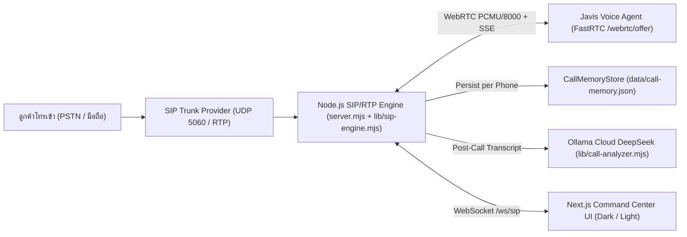

# ระบบ BC Call Center (AI 5-Line Inbound Command Center)

ศูนย์บัญชาการรับโทรศัพท์อัตโนมัติ **5 คู่สาย** (Inbound-Only) สร้างด้วย **Next.js 15 + Node.js SIP/RTP Engine + WebRTC Javis AI + Ollama Cloud DeepSeek QA** รองรับการรับสายอัตโนมัติด้วย AI, จดจำประวัติการคุยรายเบอร์เพื่อสนทนาต่อเนื่องเมื่อลูกค้าโทรเข้ามาใหม่, สลับโหมดมืด/สว่าง และวิเคราะห์คุณภาพสายอัตโนมัติหลังวางสาย


---

## Objective (เป้าหมายของระบบ)
- รับสายโทรศัพท์ลูกค้าพร้อมกันสูงสุด **5 คู่สาย** ผ่าน SIP Trunk (UDP 5060 / G.711 PCMU 8kHz) โดยเน้น **รับสายเข้าอย่างเดียว (Inbound-Only)**
- เชื่อมต่อเสียงโทรศัพท์เข้ากับ **Javis AI Voice Agent** ผ่าน WebRTC (`werift`) เพื่อตอบคำถามลูกค้าอัตโนมัติแบบเรียลไทม์
- **จดจำประวัติการสนทนารายเบอร์**: หากลูกค้าเบอร์เดิมโทรเข้ามาใหม่ ระบบจะโหลดประวัติการคุยเดิมและส่งบริบทให้ Javis AI คุยต่อเนื่องได้ทันที
- **วิเคราะห์คุณภาพสายอัตโนมัติหลังวางสาย** ด้วย **Ollama Cloud (`deepseek-v4.1-flash`)** พร้อมให้คะแนน CSAT, คะแนน AI, อารมณ์ลูกค้า, แนวโน้มอารมณ์, สรุปวิธีแก้ไข, สิ่งที่ต้องติดตามต่อ และ AI Coaching Tip
- เจ้าหน้าที่สามารถกด **รับสายแทน AI (Take Over)**, **โอนสายให้ AI**, **ฟังเสียงสนทนา**, **ปิดไมค์**, **พักสาย**, หรือ **วางสาย** ได้ทันทีจากหน้าเว็บ

---

## Architecture & Workflow



### ขั้นตอนการทำงาน (Workflow)
1. **SIP Registration**: `SipEngine` ทำ `REGISTER` (RFC 3261 Digest Auth) พร้อม Auto Re-register และ `OPTIONS` Keep-alive
2. **Inbound Auto-Answer**: เมื่อมี `INVITE` สายเข้าและเปิดโหมด **AI รับสายอัตโนมัติ** ระบบจะจองคู่สายที่ว่าง (1–5), โหลดประวัติเดิมของเบอร์โทรนั้น, ตอบ `200 OK` พร้อมเปิด RTP socket และเชื่อมต่อ `JavisCallSession` ผ่าน WebRTC
3. **Continuous Conversation Memory**: หากเบอร์เดิมเคยโทรมาแล้ว ระบบจะส่งสรุปบริบทเดิมให้ Javis ผ่าน `/chat` เพื่อให้คุยต่อเนื่องได้ทันที พร้อมแสดงป้าย **ลูกค้าเก่า** บนหน้าจอ
4. **Live Command Center Monitoring**: หน้าเว็บแสดง Motion Graphic เรดาร์/คลื่นเสียง Equalizer, คำบรรยายสด (`aiTranscript`) และปุ่มให้เจ้าหน้าที่กดแทรกมารับสายแทน AI ได้ตลอดเวลา
5. **Post-Call QA Analysis**: เมื่อวางสาย ระบบบันทึกบทสนทนาลง `data/call-memory.json` และส่งวิเคราะห์ด้วย Ollama Cloud DeepSeek อัตโนมัติ สามารถคลิกดูผลวิเคราะห์และบทสนทนาเต็มได้จากแท็บ **บันทึก QA**

---

## Configuration

คัดลอกไฟล์ `.env.example` เป็น `.env.local` แล้วกรอกค่าจริง (**ห้าม commit `.env.local` หรือ `data/` ลง Git**):

```bash
cp .env.example .env.local
```

| ตัวแปร | คำอธิบาย |
| :--- | :--- |
| `SIP_HOST` | Hostname หรือ IP ของ SIP Server |
| `SIP_FAILOVER_HOST` | IP สำรอง (ถ้ามี) |
| `SIP_PORT` | พอร์ต SIP (ค่าเริ่มต้น `5060`) |
| `SIP_USER` | Username / เบอร์ Trunk |
| `SIP_PASSWORD` | รหัสผ่าน SIP (เก็บใน `.env.local` เท่านั้น) |
| `SIP_MAX_LINES` | จำนวนคู่สายสูงสุด (ค่าเริ่มต้น `5`) |
| `PORT` | พอร์ต HTTP/WebSocket ของ Next.js (ค่าเริ่มต้น `3000`) |
| `JAVIS_URL` | URL ของ Javis Voice Agent (เช่น `http://127.0.0.1:7861`) |
| `AUTO_ANSWER_AI` | เปิดรับสายอัตโนมัติด้วย AI (`true` / `false`) |
| `OLLAMA_BASE_URL` | Endpoint ของ Ollama Cloud (`https://ollama.com`) |
| `OLLAMA_MODEL` | โมเดล DeepSeek ล่าสุด (เช่น `deepseek-v4.1-flash`) |
| `OLLAMA_API_KEY` | API Key ของ Ollama Cloud (เก็บใน `.env.local` เท่านั้น) |

---

## Dependencies & Usage

### ความต้องการของระบบ
- Node.js 22+ (แนะนำ Node.js 24 สำหรับ `process.loadEnvFile`)
- เปิด Firewall UDP `5060` และช่วง RTP `20000–30000` (หรือช่วงตามที่ SIP Provider กำหนด)
- Javis Voice Agent ที่เปิด `/webrtc/offer`, `/outputs` และ `/chat`

### การติดตั้งและรันใช้งาน
```bash
npm install
npm run typecheck
npm run build
npm run start
```

สำหรับโหมดพัฒนา:
```bash
npm run dev
```

เปิดใช้งานผ่านเบราว์เซอร์ที่ `http://localhost:3000` (หรือโดเมน Production ที่ตั้งค่า Reverse Proxy ไว้)

---

## Limitations & Security Notes
- ระบบเสียงฝั่งเบราว์เซอร์ต้องกดปุ่ม **เปิดเสียง/ไมค์** 1 ครั้ง (หรือกด **รับสายแทน AI**) เพื่อขอสิทธิ์ไมโครโฟนและปลดล็อก Autoplay Policy ของเบราว์เซอร์
- ข้อมูลประวัติการคุยและผล QA เก็บในไฟล์โลคอล `data/call-memory.json` (ถูกกันออกจาก Git ผ่าน `.gitignore`)
- รหัสผ่าน SIP, API Key และข้อมูลลูกค้าไม่ถูกฝังในโค้ดฝั่ง client และถูกกันออกจาก Git ทั้งหมด
