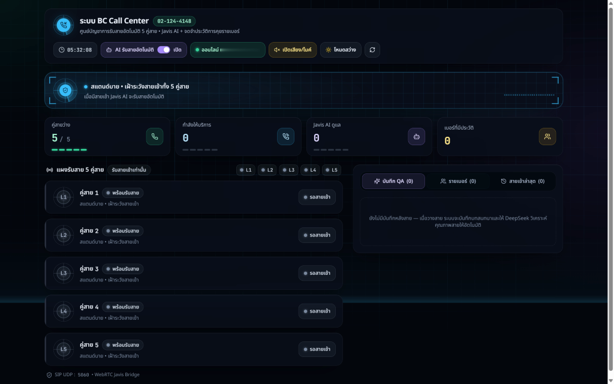
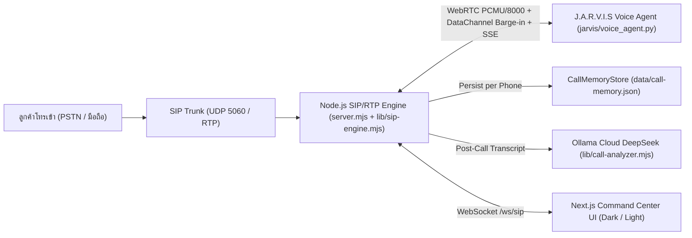

# ระบบ BC Call Center + J.A.R.V.I.S (AI 5-Line Inbound Command Center)

ศูนย์บัญชาการรับโทรศัพท์อัตโนมัติ **5 คู่สาย** (Inbound-Only) ที่รวม **Next.js 15 Command Center + Node.js SIP/RTP Engine + J.A.R.V.I.S Voice Agent (`./jarvis`) + Ollama Cloud DeepSeek QA** ไว้ในโปรเจกต์เดียว รองรับการรับสายอัตโนมัติด้วย **J.A.R.V.I.S**, พูดสวนหยุดฟังทันที (Fast Barge-in), จดจำประวัติการคุยรายเบอร์เพื่อสนทนาต่อเนื่อง, โหมดมืด/สว่าง และวิเคราะห์คุณภาพสายอัตโนมัติหลังวางสาย




---

## Objective (เป้าหมายของระบบ)
- **รวมระบบไว้ในที่เดียว (Unified Monorepo)**: โค้ดหน้าจอ/SIP Engine (`server.mjs`, `lib/`, `src/`) และโค้ดผู้ช่วยเสียง **J.A.R.V.I.S** (`jarvis/`) อยู่ในโปรเจกต์เดียวกัน แก้ไขและดูแลได้จากที่เดียว
- **รับสายเข้าพร้อมกันสูงสุด 5 คู่สาย (Inbound-Only)** ผ่าน SIP Trunk (UDP 5060 / G.711 PCMU 8kHz) พร้อม Motion Graphic เรดาร์/คลื่นเสียง Equalizer แนวศูนย์บัญชาการ
- **คุยโทรศัพท์ธรรมชาติด้วย J.A.R.V.I.S**: รองรับโหมดโทรศัพท์ตอบสั้นกระชับ 1–2 ประโยค และ Fast Barge-in เมื่อผู้โทรพูดสวน J.A.R.V.I.S จะหยุดพูดและรอฟังทันที
- **จดจำประวัติการสนทนารายเบอร์**: เมื่อลูกค้าเบอร์เดิมโทรเข้ามาใหม่ ระบบโหลดประวัติเดิมและส่งบริบทให้ J.A.R.V.I.S คุยต่อเนื่องได้ทันที
- **วิเคราะห์คุณภาพสายอัตโนมัติหลังวางสาย (Post-Call QA)** ด้วย **Ollama Cloud (`deepseek-v4.1-flash`)** แสดงคะแนน CSAT (`/10`), คะแนนคุณภาพ AI (`/10`), อารมณ์และแนวโน้มอารมณ์ลูกค้า, หัวข้อ/สรุปบทสนทนา, สถานะและวิธีแก้ไข, ความเร่งด่วน/Follow-up และ AI Coaching Tip

---

## Architecture & Workflow



### โครงสร้างโปรเจกต์
- `server.mjs` — Next.js Production/Dev Server + WebSocket (`/ws/sip`)
- `lib/sip-engine.mjs` — SIP UDP Trunk (5 คู่สาย), RTP Audio Bridge, Auto-Answer และ Post-Call QA trigger
- `lib/jarvis-bridge.mjs` — WebRTC Bridge (`werift`, PCMU/8000) + DataChannel/Energy Fast Barge-in
- `lib/call-memory.mjs` — เก็บประวัติการสนทนารายเบอร์และสร้างบริบทคุยต่อเนื่อง (`data/call-memory.json`)
- `lib/call-analyzer.mjs` — วิเคราะห์หลังวางสายผ่าน Ollama Cloud (`deepseek-v4.1-flash`)
- `jarvis/` — ซอร์สโค้ด **J.A.R.V.I.S Voice Agent** (`voice_agent.py`, `config.py`, `grounding.py`, `openthai_asr.py`, `google_tools.py`, `desktop_agent.py`, `static/`)
- `src/` — หน้าจอ **ระบบ BC Call Center** (โหมดมืด/สว่าง, Motion Graphic, แผง 5 คู่สาย, ลิ้นชักผล QA และประวัติรายเบอร์)
- `scripts/start-jarvis.ps1` — สคริปต์รัน J.A.R.V.I.S จากโฟลเดอร์ `jarvis/`
- `livekit-voice-ai/` — ชุดสถาปัตยกรรม **Full-Duplex LiveKit Server + LiveKit SIP + LiveKit Agents (Python v1.x)** แบบแยกโฟลเดอร์ (Inbound-Only + Asterisk PJSIP Registrar สำหรับ Yalecom + DTMF Fast-Path + SIP REFER Transfer + Thai Normalizer + Streaming TTS) ดูรายละเอียดเพิ่มเติมที่ [livekit-voice-ai/README.md](livekit-voice-ai/README.md)

---

## Configuration

### 1. ตั้งค่า BC Call Center (`.env.local`)
คัดลอก `.env.example` เป็น `.env.local` (**ห้าม commit `.env.local` หรือ `data/` ลง Git**):

| ตัวแปร | คำอธิบาย |
| :--- | :--- |
| `SIP_HOST` | Hostname หรือ IP ของ SIP Server |
| `SIP_FAILOVER_HOST` | IP สำรอง (ถ้ามี) |
| `SIP_PORT` | พอร์ต SIP (ค่าเริ่มต้น `5060`) |
| `SIP_USER` | Username / เบอร์ Trunk |
| `SIP_PASSWORD` | รหัสผ่าน SIP (เก็บใน `.env.local` เท่านั้น) |
| `SIP_MAX_LINES` | จำนวนคู่สายสูงสุด (ค่าเริ่มต้น `5`) |
| `PORT` | พอร์ต HTTP/WebSocket ของ Next.js (ค่าเริ่มต้น `3000`) |
| `JARVIS_URL` | Endpoint ภายในของ J.A.R.V.I.S (ค่าเริ่มต้น `http://127.0.0.1:7861`) |
| `AUTO_ANSWER_AI` | เปิดรับสายอัตโนมัติด้วย J.A.R.V.I.S (`true` / `false`) |
| `OLLAMA_BASE_URL` | Endpoint ของ Ollama Cloud (`https://ollama.com`) |
| `OLLAMA_MODEL` | โมเดล DeepSeek ล่าสุด (เช่น `deepseek-v4.1-flash`) |
| `OLLAMA_API_KEY` | API Key ของ Ollama Cloud (เก็บใน `.env.local` เท่านั้น) |

### 2. ตั้งค่า J.A.R.V.I.S (`jarvis/.env`)
คัดลอก `jarvis/.env.example` เป็น `jarvis/.env` แล้วใส่ `DEEPSEEK_API_KEY` (และเตรียมโฟลเดอร์โมเดลใน `jarvis/models/`):

```env
DEEPSEEK_API_KEY=your_deepseek_api_key_here
PORT=7860
PUBLIC_PORT=7861
PUBLIC_SSH=
```

---

## Dependencies & Usage

### ความต้องการของระบบ
- Node.js 22+ (แนะนำ Node.js 24)
- Python 3.12 + CUDA GPU สำหรับรัน J.A.R.V.I.S (`jarvis/requirements.txt`)
- เปิด Firewall UDP `5060` และช่วง RTP `20000–30000`

### การติดตั้งและรันใช้งาน
```bash
# 1. ติดตั้งและ Build ฝั่ง BC Call Center
npm install
npm run typecheck
npm run build

# 2. รัน J.A.R.V.I.S Voice Agent (เทอร์มินัลที่ 1)
npm run jarvis

# 3. รันระบบ BC Call Center (เทอร์มินัลที่ 2)
npm run start
```

เปิดใช้งานผ่านเบราว์เซอร์ที่ `http://localhost:3000` หรือโดเมน Production ที่ตั้งค่า Reverse Proxy ไว้

---

## Limitations & Security Notes
- เบราว์เซอร์ต้องกดปุ่ม **เปิดเสียง/ไมค์** 1 ครั้ง (หรือกด **รับสายแทน AI**) เพื่อขอสิทธิ์ไมโครโฟนและปลดล็อก Autoplay Policy
- ไฟล์ความลับและข้อมูล runtime ทั้งหมด (`.env.local`, `jarvis/.env`, `jarvis/models/`, `jarvis/.venv/`, `jarvis/sessions/`, `data/`) ถูกกันออกจาก Git ผ่าน `.gitignore`
- ไม่มีรหัสผ่าน, API Key, Public IP หรือเบอร์มือถือส่วนตัวฝังในซอร์สโค้ดหรือภาพหน้าจอที่อยู่ใน Repository
