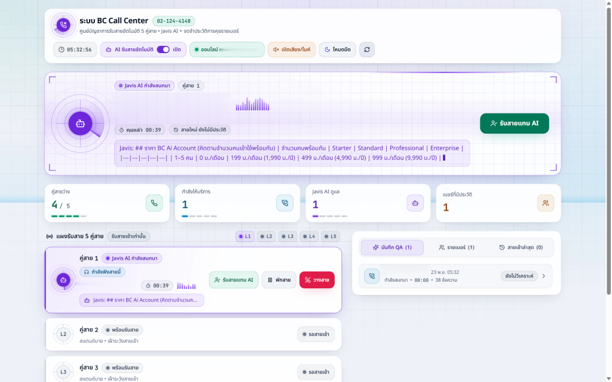
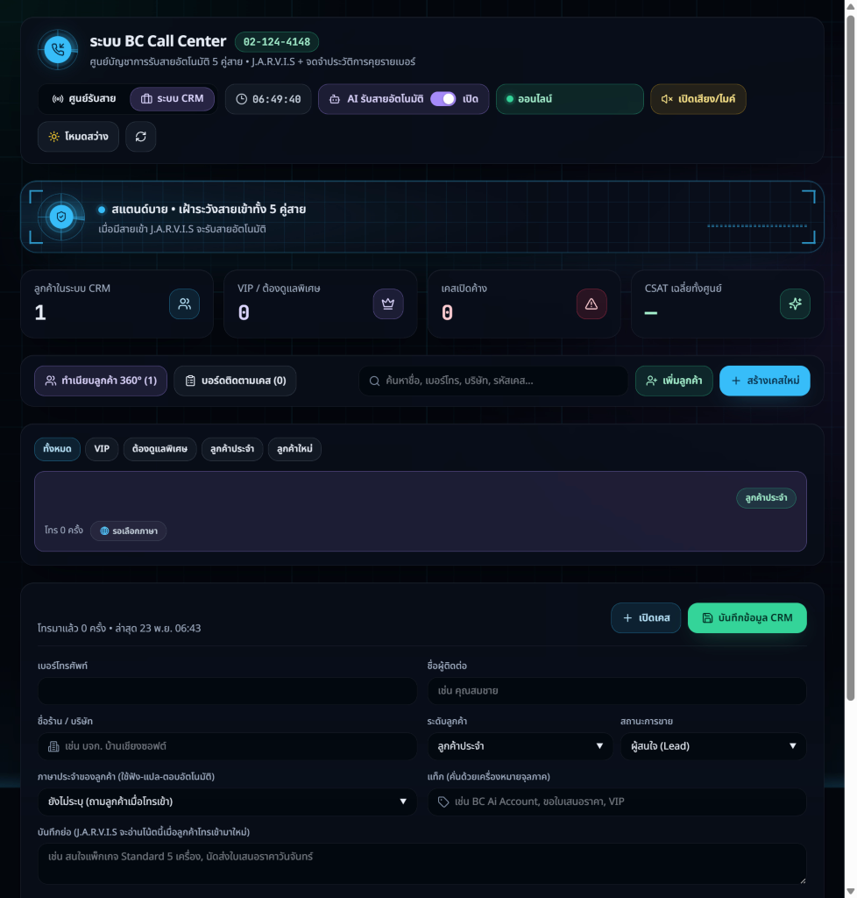
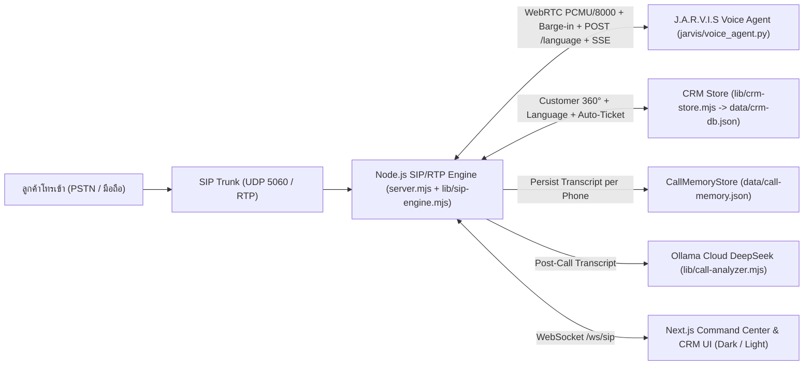

# ระบบ BC Call Center + J.A.R.V.I.S + CRM (AI 5-Line Inbound Command Center)

ศูนย์บัญชาการรับโทรศัพท์อัตโนมัติ **5 คู่สาย** (Inbound-Only) ที่รวม **Next.js 15 Command Center + Node.js SIP/RTP Engine + J.A.R.V.I.S Voice Agent (`./jarvis`) + ระบบ CRM 360° & บอร์ดติดตามเคส + ระบบสนทนาหลายภาษาอัตโนมัติ + Ollama Cloud DeepSeek QA** ไว้ในโปรเจกต์เดียว






---

## Objective (เป้าหมายของระบบ)
- **รวมระบบไว้ในที่เดียว (Unified Monorepo)**: รวม Frontend/SIP Engine (`server.mjs`, `lib/`, `src/`), ผู้ช่วยเสียง **J.A.R.V.I.S** (`jarvis/`) และชุดสถาปัตยกรรม **LiveKit SIP + LiveKit Agents** (`livekit-voice-ai/`) ไว้ในโปรเจกต์เดียว
- **2 บทบาทหลักของ J.A.R.V.I.S (Dual Role — Sales + Call Center) แบบเป็นธรรมชาติไม่น่าเบื่อ**:
  - **พนักงานขายโปรแกรม BC Ai Account**: คุยแบบเพื่อนผ่อนคลาย มีอารมณ์ในน้ำเสียง ไม่ซักไซ้ถามเยอะ ดึงให้ลูกค้าอยากคุยต่อสบายใจ พร้อมแนะนำจุดเด่น/โมดูลจากคลังความรู้จริงและรับฝากข้อมูลติดต่อกลับให้ทีมเดโม
  - **พนักงาน Call Center แนะนำการใช้งาน**: ช่วยตอบวิธีใช้งาน เมนู ขั้นตอน การตั้งค่า และแก้ไขปัญหาโปรแกรม BC Ai Account ตรงจุดทีละขั้น
  - **คลังความรู้ bcbrain แบบเร็วพิเศษ (3-Tier Smart Search + Zero-Latency Multi-Ear Prefetch + Single Round-Trip ~52ms + TTL Cache)**: J.A.R.V.I.S แบ่งการค้นหาสายโทรศัพท์เป็น 3 ชั้นอัตโนมัติ: (1) `QA_CACHE` ตอบใน ~10ms, (2) **Fast-Path** ยิง **`quick_answer`** (~52ms) ทันทีเมื่อคำพูดชัดและหู 1–2 ตรงกัน, (3) **AI Search Planner (`words_early`) + Zero-Latency Multi-Ear Context Fallback** (`_build_phone_fallback_queries`) รวมคำจากหูหลัก + หูสำรอง (`e2/e3`) + บริบท 4 รอบล่าสุดมายิง **`quick_answer`** ขนาน 2 มุม (~52ms, ไม่ค้างรอ planner นานเกินเกณฑ์) พร้อม `lookup_menu` / `batch_read` (ซ่อน tool เก่า `search_brain`/`read_note`/`ask_brain` ออกจาก LLM schema และจำกัด `SIP_MAX_TOOL_ROUNDS = 2`) พร้อม In-Memory Cache 60 วินาที (ชุดทดสอบ: `python scripts/test-mcp-startup.py`, `python scripts/test-voice-quality.py`)
  - **ส่งเบอร์โทรเข้า J.A.R.V.I.S + แนะนำตัวว่าเป็น AI + จำชื่อ & ยืนยันเบอร์โทรกลับ**: ส่งหมายเลขผู้โทร (`caller_phone`) และข้อมูลลูกค้าจาก CRM เข้าสู่ J.A.R.V.I.S โดยตรงพร้อมเก็บโปรไฟล์รายเบอร์ (`jarvis/sessions/caller_profiles.json`): สายใหม่ครั้งแรกจะแนะนำตัวว่าเป็นผู้ช่วย **AI** และแจ้งว่าถ้าต้องการคุยกับพนักงานจริงสามารถแจ้งให้โทรกลับได้ พร้อมถามขอชื่อลูกค้าให้สำเร็จ ทักทายลูกค้าเก่าด้วยชื่อทันที, ตอบเบอร์โทรที่โทรเข้ามาได้ และหากขอคุยกับพนักงานจริงหรือขอให้โทรกลับจะถามยืนยันก่อนเสมอว่าจะให้โทรกลับเบอร์นี้หรือเบอร์อื่น และถามเรื่องที่ต้องการให้โทรกลับ (ปัญหาของโปรแกรมหรือเรื่องอื่น) หากสายนี้ยังไม่มีหัวข้อคุยต่อเนื่อง ก่อนบันทึก `leave_message` (พร้อมกันคำตอบส่วนบุคคลหลุดเข้า QA Cache และวนคำรอสั้นๆ 8 คำไม่ซ้ำซาก)
- **รับสายเข้าพร้อมกันสูงสุด 5 คู่สาย (Inbound-Only) พร้อมหน้าจอ Realtime 100%** ผ่าน SIP Trunk (UDP 5060 / G.711 PCMU 8kHz), WebSocket Heartbeat + Watchdog Auto-Reconnect (`LIVE` latency indicator), บทสนทนาสด (Live Transcript Feed + คำพูดสดแบบ Karaoke ทุก 180ms), Live Audio Meter จริง (ผู้โทร/AI), Motion Graphic เรดาร์/คลื่นเสียง และโหมดมืด/สว่าง
- **กระแสเสียงต่อเนื่อง 20ms Outbound RTP + ElevenLabs `eleven_v4_turbo` Streaming TTS + Local Cache**:
  - ตัวส่งกระแสเสียง `20ms` Drift-Compensated Outbound RTP Pacer พร้อม Pre-buffer 60ms และ Barge-in Flush ใน `lib/sip-engine.mjs` ทำให้เสียงไหลออกสายโทรศัพท์สม่ำเสมอไม่กระตุก
  - รองรับ **ElevenLabs `eleven_v4_turbo` Streaming TTS** (`jarvis/elevenlabs_tts.py`, TTFA ~145–240ms, ไม่ใช้ GPU เครื่อง, รองรับภาษาไทยและหลายภาษา) พร้อม fallback อัตโนมัติไป Local OmniVoice หากไม่ได้ตั้งค่า `ELEVENLABS_API_KEY`
  - **Local Disk TTS Cache (`jarvis/cache/tts/`) & Ollama Cloud DeepSeek FAQ Cache (`jarvis/cache/qa_cache.json`)**: เก็บไฟล์เสียง PCM 24kHz ลงดิสก์ (LRU สูงสุด 500 MB) และเก็บคำตอบ FAQ ที่ผ่าน Judge จาก **Ollama Cloud (`deepseek-v4.1-flash`, `reasoning_effort="none"`)** แล้ว (TTL 7 วัน, จับคำถามซ้ำ/หางเสียงต่าง/ใกล้เคียงอัตโนมัติ, กันคำตอบขัดข้องไม่ให้เข้า cache) เพื่อประหยัดทั้งเครดิต ElevenLabs และ LLM Token (ตรวจสถิติได้ที่ `GET /cache/stats`)
- **ระบบกันเสียงไอ/เสียงรบกวนรอบข้าง + Word-Verified Barge-in**:
  - กรองเสียงฮัม/ลมความถี่ต่ำด้วย **80 Hz High-Pass Filter** (`scipy.signal.butter/sosfilt`), **Noise Floor Gate (`-41 dBFS` สำหรับการรับสาย / `-36 dBFS` สำหรับพูดแทรก)**, ยืนยันเสียงพูดจริงด้วย STT VAD (`voiced()`) ใน `determine_pause` ก่อนเริ่ม turn พร้อม **Semantic Incomplete-Turn Extension** (`0.55s` ปกติ / ขยายเป็น `0.95s` เมื่อยังค้างคำเชื่อมเช่น "ว่า", "แล้ว", "ถ้า", "คือ" เพื่อไม่ให้ตัดคำกลางประโยค), กรองเสียงหลุดสั้นกว่า `0.15s` (`SIP_MIN_TURN_SPEECH_S`) พร้อมกันการตรวจซ้ำใน `process_audio` และกันจับคำเชื่อม/อุทานเป็นชื่อลูกค้า (ชุดทดสอบ: `python scripts/test-turn-onset.py`, `python scripts/test-voice-quality.py`)
  - ขณะบอทกำลังพูดจะไม่ตัดคำตอบจากเสียงไอ/กระแอม/เสียงเคาะสั้น 100ms แต่ใช้ **OpenThai CPU Streaming** ตรวจยืนยันคำพูดแทรกจริง (`barge_in_confirmed` + ล้างคิว 20ms RTP ทันที, วัดระดับเสียงพูดล้วนย้อนหลัง `SIP_BARGE_LEVEL_SPAN_S = 3.0` วิเมื่อเสียงช่วงท้ายถูกสายลดระดับ และปิดตัวกรองเสียงสะท้อน `is_echo` เฉพาะสายโทรศัพท์เพื่อไม่ให้ตัดคำแทรกที่ซ้ำคำบอทหรือคำตอบ "ใช่") ชุดทดสอบ: `python scripts/test-barge-in.py`
- **ระบบฟัง 3 หูขนาน 6 ภาษา (Dual-Mode Triple-Ear ASR — ไทย / ลาว / อังกฤษ / จีน / ญี่ปุ่น / เกาหลี)**:
  - **สายภาษาไทย (GPU + CPU ขนานแบบแยก Pool)**: หูที่ 1 ใช้ **`typhoon-whisper-turbo`** บน GPU (`language="th"`, `BC_STT_PROMPT`, `repetition_penalty=1.15`, `no_repeat_ngram_size=3`, และตัวตรวจคำซ้ำพยางค์สลับไป OpenThai อัตโนมัติ, CER 2.3% ไม่หลอนเสียงไทยเป็นภาษาอังกฤษ) พร้อม GPU busy semaphore กันคิวกอง timeout เป็นลูกโซ่ คู่กับ **หูที่ 2 (`OpenThai 2.0 th-TH`)** และ **หูที่ 3 (`OpenThai 2.0 th-mix`)** บน CPU Pool แยกต่างหากสำหรับตรวจคำแทรก (Word-Verified Barge-in) และจับคำขอเปลี่ยนภาษา/ประโยคอังกฤษล้วน
  - **สายภาษาอื่น (`en / zh / ja / ko / lo`)**: หูที่ 1 ใช้ **`faster-whisper-large-v3-turbo`** บน CPU (`int8`, `0 GB GPU VRAM`) ถอดเสียงเป็นอักษรของภาษานั้นแท้ๆ โดยไม่ทับศัพท์เป็นคำไทย พร้อม OpenThai CPU ขนานเพื่อรับคำสั่งกลับภาษาไทย
  - พูดเสียงแจ้งคั่นระหว่างค้นข้อมูลแบบสุ่ม 8 คำสั้นๆ เป็นธรรมชาติ (ไม่ขึ้นต้นด้วย "อ๋อ" ซ้ำซาก, Pre-rendered 0ms ไม่ใช้ GPU ตอนโทร)
- **บันทึกเสียงสนทนาจริง (Dual-Channel WAV) + เล่นย้อนหลัง Sync บทสนทนา + ปุ่มสอน AI 1 คลิก**:
  - `lib/call-recorder.mjs` บันทึกไฟล์เสียง Stereo 8kHz (`data/recordings/<sessionId>.wav`, ช่องซ้าย = ผู้โทร, ช่องขวา = J.A.R.V.I.S/เจ้าหน้าที่) สงวนสิทธิ์เปิดฟังเฉพาะแอดมินผ่าน `GET /api/recordings/:sessionId` (รองรับ HTTP Range Seek)
  - ในลิ้นชัก QA (`CallQaDrawer.tsx`) คลิกปุ่มเวลาในบทสนทนาเพื่อข้ามเสียงไปวินาทีนั้นทันที พร้อมปุ่ม **"สอน AI"** 1 คลิก (`POST /api/teach`) บันทึกคำตอบที่ถูกต้องลงคลัง FAQ ของ J.A.R.V.I.S เพื่อตอบได้ทันทีในสายถัดไป
- **Live Buying Signal + แดชบอร์ดสถิติ & Cache ROI + Emotion-Aware Voice + Auto Follow-up Card**:
  - แสดงป้าย **สัญญาณอารมณ์ & โอกาสปิดการขายแบบเรียลไทม์** (`สนใจซื้อสูง` / `กำลังพิจารณา` / `คุยสบายใจ` / `เริ่มกังวล`) บนการ์ดคู่สายและ Hero
  - แท็บ **สถิติ & ROI** (`AnalyticsWorkspace.tsx` + `GET /api/analytics`): สรุปจำนวนสายรายวัน/7 วัน, CSAT & AI Quality, สัดส่วนอารมณ์, Top หัวข้อ/โมดูลที่สนใจ, สถิติประหยัดเครดิต TTS/QA Cache และตารางจัดการคลังคำตอบที่สอน AI
  - **Emotion-Aware Voice Tuning**: ปรับโทนเสียง ElevenLabs `eleven_v4_turbo` อัตโนมัติ 3 อารมณ์ (`friendly` / `empathy` / `upbeat`) ตามบริบทคำพูด
  - **Auto Follow-up Message Card**: หลังวางสาย DeepSeek สร้างข้อความสรุปสำหรับส่งลูกค้า + แท็กโมดูลที่สนใจ พร้อมปุ่มคัดลอก 1 คลิกในหน้า QA (ไม่จำเป็นต้องเชื่อมต่อ LINE API)
- **ระบบหลายภาษา: หนึ่งสายหนึ่งภาษา เปลี่ยนได้เมื่อลูกค้ายืนยันเท่านั้น (Multi-Language & Translation)**:
  - **เบอร์เดิม**: จำภาษาประจำของเบอร์นั้นจาก CRM (`preferredLanguage`) ใช้ฟัง (STT) และแปลคำตอบจากฐานความรู้เป็นภาษาของลูกค้าทันที
  - **เบอร์ใหม่**: ค่าเริ่มต้นเป็น **ภาษาไทย** พร้อมทักทายทันทีว่าคุยได้ทุกภาษา (Pre-rendered 0ms wait)
  - **ตอบภาษาเดียวตลอดสาย**: AI ตอบเป็นภาษาของสายเท่านั้น ไม่สลับภาษาเองและไม่ถามเรื่องภาษาเอง คำที่ฟังเพี้ยนเป็นภาษาอื่น (เช่น "Okay." หรือคำจีนสั้นๆ) ไม่ทำให้ภาษาเปลี่ยน
  - **เปลี่ยนภาษาต้องถามและได้คำยืนยันก่อนทุกครั้ง**: เมื่อลูกค้าพูดภาษาอื่นชัดเจน หรือพูดขอเปลี่ยนภาษา ระบบถาม 1 คำถามด้วยภาษานั้น ("ต้องการเปลี่ยนเป็นภาษา…ไหม") ลูกค้าตอบรับในรอบถัดไป (ใช่/ครับ/Yes/好的 หรือพูดต่อเป็นภาษานั้นชัดเจน) จึงเปลี่ยนทั้งการฟัง การตอบ เสียงพูด และบันทึกลง CRM แล้วใช้ภาษานั้นไปจนกว่าจะยืนยันเปลี่ยนอีกครั้ง ถ้าปฏิเสธหรือไม่ตอบ คำถามนั้นถูกยกเลิกและคุยภาษาเดิมต่อ
  - **เจ้าหน้าที่เปลี่ยนให้ได้ทันที**: กดเลือกภาษาบนการ์ดคู่สาย ไม่ต้องถามยืนยัน
  - ชุดทดสอบกติกา: `python scripts/test-language-rules.py` (กรณีฟังเพี้ยนจากสายจริง + ลำดับถาม-ตอบ-เปลี่ยนภาษา + การเลือกหูหลัก)
- **ระบบ CRM 360° + บอร์ดติดตามเคสอัตโนมัติ**:
  - Screen-Pop แสดงชื่อลูกค้า บริษัท ระดับ (`VIP` / `ต้องดูแลพิเศษ`) ภาษา และจำนวนเคสค้างทันทีที่สายเข้า
  - แนบข้อมูล CRM + โน้ต + เคสค้าง + ประวัติการคุยเดิมให้ **J.A.R.V.I.S** เพื่อคุยต่อเนื่องได้เหมือนพนักงานคนจริง
  - สร้างเคสติดตาม (`TCK-...`) ให้อัตโนมัติเมื่อ DeepSeek QA พบว่าสายนั้นยังแก้ไม่จบหรือต้องให้เจ้าหน้าที่ติดต่อกลับ
- **วิเคราะห์คุณภาพสายอัตโนมัติหลังวางสาย (Post-Call QA)** ด้วย **Ollama Cloud (`deepseek-v4.1-flash`)** แสดงคะแนน CSAT (`/10`), คะแนนคุณภาพ AI (`/10`), อารมณ์และแนวโน้มอารมณ์ลูกค้า, หัวข้อ/สรุปบทสนทนา, สถานะและวิธีแก้ไข, ความเร่งด่วน/Follow-up และ AI Coaching Tip
- **ระบบยืนยันตัวตนด้วย Google Sign-In และโหมดผู้ชมแบบปกปิดเบอร์ (Privacy & Read-Only Mode)**:
  - หากยังไม่ได้เข้าสู่ระบบด้วยบัญชีผู้ดูแล (`ADMIN_EMAIL`) หน้าเว็บจะเข้าสู่ **โหมดผู้ชม (ดูได้อย่างเดียว)** โดยอัตโนมัติ
  - เซิร์ฟเวอร์จะปกปิดหมายเลขโทรศัพท์ของผู้โทรทุกเบอร์ (เป็นรหัสแทน เช่น `•••-•••-••#01`), ชื่อ/บริษัทลูกค้า, IP ของ SIP Trunk และเบอร์โทรในบทสนทนา/สรุป QA ก่อนส่งผ่าน WebSocket (โดยยังแสดงเบอร์ Call Center หลักจาก `SIP_USER` ได้)
  - ปิดกั้นคำสั่งควบคุมสาย, การแก้ไข CRM/เคส, การสั่งวิเคราะห์ QA ใหม่ และการรับ-ส่งเสียงสนทนาทั้งฝั่ง UI และฝั่งเซิร์ฟเวอร์ WebSocket จนกว่าจะเข้าสู่ระบบด้วยบัญชีผู้ดูแลผ่าน Google Sign-In (`HttpOnly` HMAC-signed cookie)

---

## Architecture & Workflow



### โครงสร้างโปรเจกต์
- `server.mjs` — Next.js Production/Dev Server + Auth API (`/api/auth/*`) + WebSocket (`/ws/sip`) พร้อมบังคับสิทธิ์ผู้ดูแล/ผู้ชม
- `lib/auth.mjs` — ตรวจสอบ Google ID Token, ออก/ตรวจ `HttpOnly` HMAC-SHA256 Session Cookie และปกปิดข้อมูลหมายเลขโทรศัพท์ผู้โทรฝั่งเซิร์ฟเวอร์ (`sanitizeStateForViewer`)
- `lib/sip-engine.mjs` — SIP UDP Trunk (5 คู่สาย), RTP Audio Bridge, Auto-Answer, Multi-Language Routing, CRM Sync และ Post-Call QA trigger
- `lib/jarvis-bridge.mjs` — WebRTC Bridge (`werift`, PCMU/8000), DataChannel/Energy Fast Barge-in และซิงก์ภาษา (`POST /language`)
- `lib/crm-store.mjs` — ฐานข้อมูล CRM โลคอล (โปรไฟล์ลูกค้า 360°, ภาษาประจำเบอร์, เคสติดตามงาน และ Auto-Ticket จาก AI QA)
- `lib/call-memory.mjs` — เก็บประวัติการสนทนารายเบอร์และสร้างบริบทคุยต่อเนื่อง (`data/call-memory.json`)
- `lib/call-analyzer.mjs` — วิเคราะห์หลังวางสายผ่าน Ollama Cloud (`deepseek-v4.1-flash`)
- `jarvis/` — ซอร์สโค้ด **J.A.R.V.I.S Voice Agent** (`voice_agent.py`, `config.py`, `grounding.py`, `openthai_asr.py`, `google_tools.py`, `desktop_agent.py`, `static/`) รองรับ STT/TTS หลายภาษาและ `POST /language`
- `src/` — หน้าจอ **ระบบ BC Call Center** (โหมดมืด/สว่าง, Motion Graphic, แผง 5 คู่สายพร้อมปุ่มสลับภาษากลางสาย, ลิ้นชักผล QA และ **CRM Workspace**)
- `scripts/start-jarvis.ps1` — สคริปต์รัน J.A.R.V.I.S จากโฟลเดอร์ `jarvis/`
- `scripts/dev-on-the-fly-scan.mjs` — สแกนสายใหม่ที่อัดเสียงไว้ (`data/recordings/*.wav`), กันรีวิวซ้อนกันด้วย lock (`--lock`), ดึง log ของ J.A.R.V.I.S ในช่วงเวลาของสาย โดยตัดบรรทัดไล่ที่อยู่เครือข่าย (ICE) ออกให้เหลือเฉพาะบทสนทนา (`--jarvis-log`), ตรวจสายว่างก่อน Deploy (`--check-idle`) และบันทึกผลรีวิว (`--mark-done`) สำหรับระบบ **Dev on the Fly** (งานตั้งเวลารายชั่วโมงบน Claude Code — ขั้นตอนทั้งหมดอยู่ที่ [docs/dev-on-the-fly.md](docs/dev-on-the-fly.md))
- `scripts/wav-analyze.mjs` + `scripts/wav-transcribe.py` — วิเคราะห์ไฟล์เสียงสองช่องของแต่ละสาย: เวลาที่ AI ใช้ตอบ, การพูดแทรก/พูดทับ, ช่วงเงียบ, ระดับเสียง และถอดเสียงซ้ำแยกช่องด้วย Whisper large-v3-turbo พร้อมภาษาที่ตรวจพบ
- `scripts/restart-services.ps1` — รีสตาร์ท J.A.R.V.I.S / production server แบบเบื้องหลังเฉพาะเมื่อไม่มีสายค้าง แล้วตรวจว่าเว็บตอบ 200 (log อยู่ที่ `data/logs/server.log` และ `jarvis/logs/voice_agent.log`)
- `livekit-voice-ai/` — ชุดสถาปัตยกรรม **Full-Duplex LiveKit Server + LiveKit SIP + LiveKit Agents (Python v1.x)** (Inbound-Only + Asterisk PJSIP Registrar + Multi-Language STT/LLM + DTMF Fast-Path + SIP REFER Transfer + Thai Normalizer) ดูรายละเอียดเพิ่มเติมที่ [livekit-voice-ai/README.md](livekit-voice-ai/README.md)

---

## Configuration

### 1. ตั้งค่า BC Call Center (`.env.local`)
คัดลอก `.env.example` เป็น `.env.local` (**ห้าม commit `.env.local` หรือ `data/` ลง Git**):

| ตัวแปร | คำอธิบาย |
| :--- | :--- |
| `SIP_HOST` | Hostname หรือ IP ของ SIP Server |
| `SIP_FAILOVER_HOST` | IP สำรอง (ถ้ามี) |
| `SIP_PORT` | พอร์ต SIP (ค่าเริ่มต้น `5060`) |
| `SIP_USER` | Username / เบอร์ Trunk |
| `SIP_PASSWORD` | รหัสผ่าน SIP (เก็บใน `.env.local` เท่านั้น) |
| `SIP_MAX_LINES` | จำนวนคู่สายสูงสุด (ค่าเริ่มต้น `5`) |
| `PORT` | พอร์ต HTTP/WebSocket ของ Next.js (ค่าเริ่มต้น `3000`) |
| `JARVIS_URL` | Endpoint ภายในของ J.A.R.V.I.S (ค่าเริ่มต้น `http://127.0.0.1:7861`) |
| `AUTO_ANSWER_AI` | เปิดรับสายอัตโนมัติด้วย J.A.R.V.I.S (`true` / `false`) |
| `OLLAMA_BASE_URL` | Endpoint ของ Ollama Cloud (`https://ollama.com`) |
| `OLLAMA_MODEL` | โมเดล DeepSeek ล่าสุด (เช่น `deepseek-v4.1-flash`) |
| `OLLAMA_API_KEY` | API Key ของ Ollama Cloud (เก็บใน `.env.local` เท่านั้น) |
| `GOOGLE_CLIENT_ID` | Google OAuth 2.0 Web Client ID สำหรับปุ่มเข้าสู่ระบบด้วย Google (ต้องเพิ่มโดเมนใน Authorized JavaScript origins ใน Google Cloud Console) |
| `ADMIN_EMAIL` | อีเมลบัญชี Google ที่มีสิทธิ์ผู้ดูแลเต็มรูปแบบ (ดูเบอร์จริงและควบคุมระบบได้) |
| `AUTH_COOKIE_SECRET` | คีย์สุ่มสำหรับลงนาม `HttpOnly` Session Cookie (เก็บใน `.env.local` เท่านั้น) |

### 2. ตั้งค่า J.A.R.V.I.S (`jarvis/.env`)
คัดลอก `jarvis/.env.example` เป็น `jarvis/.env` แล้วใส่ `DEEPSEEK_API_KEY` (และเตรียมโฟลเดอร์โมเดลใน `jarvis/models/`):

```env
DEEPSEEK_API_KEY=your_deepseek_api_key_here
TTS_PROVIDER=auto
ELEVENLABS_API_KEY=your_elevenlabs_api_key_here
ELEVENLABS_VOICE_ID=H9eYlNHpm1vah6PPgYAk
ELEVENLABS_MODEL_ID=eleven_v4_turbo
PORT=7860
PUBLIC_PORT=7861
PUBLIC_SSH=
```

---

## Dependencies & Usage

```bash
# 1. ติดตั้งและ Build ฝั่ง BC Call Center
npm install
npm run typecheck
npm run build

# 2. รัน J.A.R.V.I.S Voice Agent (เทอร์มินัลที่ 1)
npm run jarvis

# 3. รันระบบ BC Call Center (เทอร์มินัลที่ 2)
npm run start

# 4. (ทางเลือกแทนข้อ 2-3) เปิด/รีสตาร์ททั้งสองบริการแบบเบื้องหลังเมื่อไม่มีสายค้าง แล้วตรวจ HTTP 200
powershell -NoProfile -ExecutionPolicy Bypass -File scripts/restart-services.ps1 -Target all

# 5. วิเคราะห์คุณภาพสายจากไฟล์เสียงที่อัดไว้
node scripts/wav-analyze.mjs <sessionId> --transcribe
```

---

## Limitations & Security Notes
- เบราว์เซอร์ต้องกดปุ่ม **เปิดเสียง/ไมค์** 1 ครั้ง (หรือกด **รับสายแทน AI**) เพื่อขอสิทธิ์ไมโครโฟนและปลดล็อก Autoplay Policy
- ไฟล์ความลับและข้อมูล runtime ทั้งหมด (`.env.local`, `jarvis/.env`, `jarvis/models/`, `jarvis/.venv/`, `jarvis/sessions/`, `livekit-voice-ai/.env`, `livekit-voice-ai/asterisk/pjsip.conf`, `data/`) ถูกกันออกจาก Git ผ่าน `.gitignore`
- ไม่มีรหัสผ่าน, API Key, Public IP หรือเบอร์มือถือส่วนตัวฝังในซอร์สโค้ดหรือภาพหน้าจอที่อยู่ใน Repository

---

## Credits & Open-Source Attribution
ระบบนี้พัฒนาต่อยอดและผสานการทำงานร่วมกับโครงการโอเพ่นซอร์สชั้นนำดังนี้:
- **Repository หลัก**: [jaturapornchai/bccallcenter](https://github.com/jaturapornchai/bccallcenter)
- **Web Framework**: [Next.js](https://github.com/vercel/next.js)
- **Node.js WebRTC Bridge**: [werift-webrtc](https://github.com/shinyoshiaki/werift-webrtc)
- **Real-time Voice Transport**: [FastRTC](https://github.com/gradio-app/fastrtc) & [LiveKit Agents](https://github.com/livekit/agents)
- **Speech-to-Text (STT)**: [Faster-Whisper](https://github.com/SYSTRAN/faster-whisper)
- **Multilingual Text-to-Speech (TTS)**: [k2-fsa/OmniVoice](https://github.com/k2-fsa/OmniVoice)
- **LLM & Post-Call QA**: [Ollama](https://github.com/ollama/ollama) (DeepSeek)
