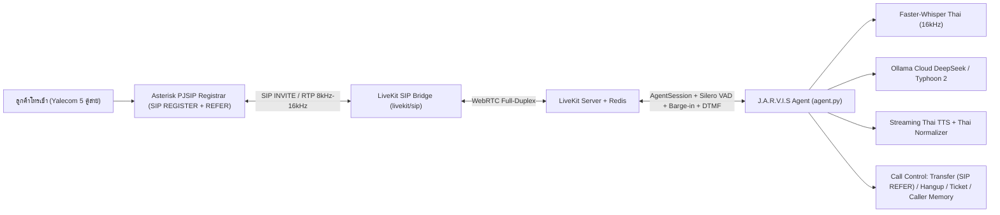

# Full-Duplex Thai Voice AI Call Center (LiveKit Server + LiveKit SIP + J.A.R.V.I.S)

ชุดสถาปัตยกรรมแยกเฉพาะสำหรับทดลอง/ขยายระบบ **Inbound-Only Thai Voice AI Call Center** บน **LiveKit Server + LiveKit SIP Bridge + LiveKit Agents (Python v1.x)** โดยไม่กระทบระบบ BC Call Center เดิมที่รันบนพอร์ต `3000` / `5060`

---

## Objective & Architecture



> [!IMPORTANT]
> **ข้อเท็จจริงสำคัญเรื่อง Yalecom (Username/Password Register) กับ LiveKit SIP**:
> `livekit/sip` เป็นแบบ **INVITE-only** (ไม่ส่ง `SIP REGISTER` ออกไปหา SIP Provider เอง) ดังนั้นใน `docker-compose.yml` จึงเตรียม Profile `yalecom-register` (`asterisk-registrar`) ไว้ทำ `SIP REGISTER` กับ Yalecom แล้วส่งสายเข้า (INVITE) และรองรับการโอนสาย (`SIP REFER`) ระหว่าง LiveKit SIP กับเบอร์ต่อภายใน หากขอ Yalecom เปลี่ยนเป็น IP Authentication ในอนาคต สามารถปิด `asterisk-registrar` แล้วต่อตรงเข้า `livekit-sip` ได้ทันที

---

## โครงสร้างไฟล์
- `docker-compose.yml` — Redis + LiveKit Server + LiveKit SIP + Asterisk Registrar (optional profile)
- `livekit.yaml` / `sip.yaml` — คอนฟิก LiveKit Server และ SIP Bridge (รองรับ PCMU/PCMA/Opus, `use_external_ip`)
- `asterisk/pjsip.conf.template` & `asterisk/extensions.conf` — คอนฟิก SIP REGISTER กับ Yalecom + Inbound-only dialplan + โอนสายไปเบอร์ต่อ `1xx`
- `sip-config/inbound-trunk.json`, `dispatch-rule.json`, `setup-sip.ps1` — สร้าง Inbound Trunk และ Dispatch Rule ผ่าน `lk` CLI
- `agent.py` — LiveKit Agents v1.x (`AgentSession`, Silero VAD, Fast Barge-in, DTMF `0/1/2`, Post-Call QA)
- `stt/thai_stt.py` — Faster-Whisper Thai / OpenAI-compatible STT (แปลง 8kHz/48kHz → 16kHz อัตโนมัติ + กรอง Hallucination)
- `llm/thai_llm.py` — Ollama Cloud `deepseek-v4.1-flash` หรือ Local Ollama `scb10x/typhoon2` + System Prompt บุคลิกพนักงาน Call Center มืออาชีพ
- `tts/thai_tts.py` — Streaming Thai TTS ทีละประโยค (รองรับ F5-TTS HTTP / OpenAI-compatible / PyThaiTTS)
- `normalizer/thai_normalizer.py` — แปลงเบอร์โทร, ราคา, บาท, เวลา, เปอร์เซ็นต์, ตัวย่อไทย และลบ Markdown/ตารางก่อนอ่านออกเสียง
- `tools/call_control.py` — เครื่องมือ `transfer_to_human` (SIP REFER), `hangup_call`, `create_callback_ticket`, `search_knowledge_base`, `lookup_caller_history`

---

## การติดตั้งและเริ่มต้นใช้งาน

### 1. ตั้งค่าไฟล์ Environment และคีย์
1. คัดลอก `.env.example` → `.env` แล้วใส่คีย์จริง (`LIVEKIT_API_SECRET`, `LLM_API_KEY`)
2. แก้ `keys` ใน `livekit.yaml` และ `api_secret` ใน `sip.yaml` ให้ตรงกับ `.env`
3. หากต่อกับ Yalecom แบบ Register: คัดลอก `asterisk/pjsip.conf.template` → `asterisk/pjsip.conf` แล้วกรอกข้อมูล Trunk จริง (**ห้าม commit `asterisk/pjsip.conf` หรือ `.env` ลง Git**)

### 2. สตาร์ท Infrastructure (Docker)
```powershell
cd d:\yalecom\livekit-voice-ai

# โหมดทดสอบเดี่ยว (พอร์ต SIP อยู่บน 5062 ไม่ชนระบบเดิม)
docker compose up -d

# หรือโหมดต่อ Yalecom จริงผ่าน Asterisk Registrar (ต้องปิดระบบพอร์ต 5060 เดิมก่อน)
docker compose --profile yalecom-register up -d
```

### 3. สร้าง Inbound Trunk & Dispatch Rule
```powershell
$env:LIVEKIT_API_KEY = "lk_bc_callcenter_key"
$env:LIVEKIT_API_SECRET = "YOUR_SECRET"
.\sip-config\setup-sip.ps1
```

### 4. รัน Python Voice Agent (J.A.R.V.I.S)
```powershell
python -m venv .venv
.\.venv\Scripts\Activate.ps1
pip install -r requirements.txt
python agent.py dev
```

---

## NAT & Firewall Checklist

| พอร์ต | โปรโตคอล | หน้าที่ | เงื่อนไข Firewall |
| :--- | :--- | :--- | :--- |
| `5060` (หรือ `5062` ตอนทดสอบ) | UDP / TCP | SIP Signaling | เปิดรับจาก IP ของ Yalecom (Main & Failover) |
| `10000–20000` | UDP | LiveKit SIP RTP Media | เปิดรับจาก IP ของ Yalecom |
| `20001–20200` | UDP | Asterisk RTP (กรณีใช้ profile `yalecom-register`) | เปิดรับจาก IP ของ Yalecom |
| `7880` | TCP | LiveKit HTTP / WebSocket | เปิดเฉพาะ LAN / Reverse Proxy TLS |
| `7881` | TCP | LiveKit WebRTC TCP Fallback | เปิดเมื่อมีลูกค้า WebRTC |
| `7882` และ `50000–50100` | UDP | LiveKit WebRTC Media | เปิดเมื่อใช้ภายนอก LAN |

### เช็กลิสต์สำคัญหลัง NAT
- ตั้ง `use_external_ip: true` ในทั้ง `livekit.yaml` และ `sip.yaml` เมื่ออยู่บน VPS/Cloud ที่มี Public IP (หากทดสอบในวง LAN/Localhost กับ MicroSIP ให้ตั้ง `false`)
- หากใช้ `asterisk-registrar` หลัง NAT Router ให้กำหนด `external_media_address`, `external_signaling_address` และ `local_net` ใน `asterisk/pjsip.conf` และทำ Port Forwarding พอร์ต UDP `5060` + RTP มายังเครื่องเซิร์ฟเวอร์
- ปิด **SIP ALG** บน Router เพื่อกันอาการเสียงหายข้างเดียว (One-way audio)

---

## วิธีทดสอบโทรเข้าด้วย Softphone (MicroSIP / Zoiper) ก่อนต่อขึ้น Yalecom จริง

1. ตั้ง `use_external_ip: false` ใน `livekit.yaml` และ `sip.yaml` แล้วรัน `docker compose up -d` + `setup-sip.ps1` + `python agent.py dev`
2. เปิด **MicroSIP** บนเครื่อง Windows (ไม่ต้องตั้ง Account/Register ก็โทร Direct SIP URI ได้)
3. พิมพ์ปลายทางในช่องโทรของ MicroSIP เป็น:
   ```text
   sip:02XXXXXXX@127.0.0.1:5062
   ```
   *(ให้เลข `02XXXXXXX` ตรงกับค่าใน `sip-config/inbound-trunk.json`)*
4. กดโทรออก → LiveKit SIP จะรับสาย, สร้างห้อง `call-...`, เรียก `jarvis-callcenter` เข้าห้อง และได้ยินเสียงทักทายของ J.A.R.V.I.S ทันที
5. ทดสอบ 3 พฤติกรรมหลัก:
   - **พูดสวน (Barge-in)**: พูดแทรกระหว่างที่ J.A.R.V.I.S กำลังพูด เสียงต้องหยุดทันทีภายในเสี้ยววินาที
   - **DTMF Fast-Path**: กด `0`, `1`, หรือ `2` บนแป้น MicroSIP ตรวจ log ว่า `sip_dtmf_received` ทำงานและสั่งโอนสาย
   - **ประวัติต่อเนื่อง + QA**: วางสายแล้วเช็ค `../data/call-memory.json` และโทรซ้ำด้วยเบอร์เดิมเพื่อดูว่า J.A.R.V.I.S ทักทายต่อเนื่องจากรอบก่อน
